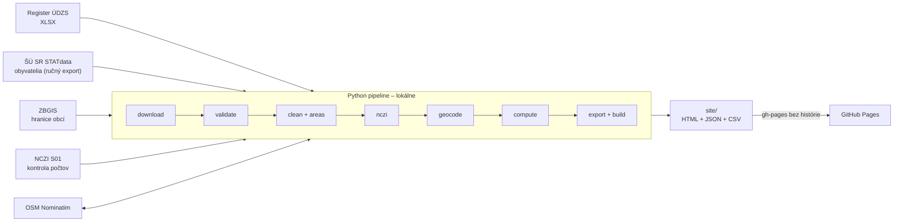

# Kde na Slovensku chýbajú lekári prvého kontaktu?

Interaktívna mapa dostupnosti **všeobecných lekárov pre dospelých** a **pediatrov prvého kontaktu** pre každý okres a obec na Slovensku. Je to neoficiálna analýza verejných dát s reprodukovateľnou dátovou pipeline a otvorenou metodikou.

> **English summary.** An unofficial open-data analysis of access to primary care physicians in Slovakia. A Python pipeline (pandas, geopandas, SQLite) finds and downloads the official provider register, validates it in every step, cross-checks counts against national health statistics (NCZI), geocodes practice addresses via OpenStreetMap Nominatim with a persistent cache and computes indicators: practices per 10,000 adults/children by district, distance to the nearest practice, and practices within 10/20 km of every municipality. The output is a static, privacy-friendly website (Leaflet, no backend, no cookies, strict CSP) hosted on GitHub Pages. Raw data with personal names never enter the Git history.

**Web:** _doplní sa po zverejnení_ · **Metodika:** [docs/metodika.md](docs/metodika.md)

## Čo stránka ukazuje

- mapu okresov zafarbenú podľa počtu ambulancií na 10 000 obyvateľov príslušnej vekovej skupiny,
- pre každú obec vzdialenosť k najbližšej ambulancii a počet ambulancií do 10 a 20 km,
- zoznam ambulancií v okolí s odkazom na oficiálne vyhľadávanie lekárov zdravotných poisťovní,
- rebríčky okresov a ukazovatele na stiahnutie (CSV).

Stránka **neukazuje**, či ambulancia prijíma pacientov, ordinačné hodiny ani počet lekárov. Register tieto údaje neobsahuje. Všetky obmedzenia sú v [metodike](docs/metodika.md).

## Architektúra



| Vrstva | Technológie |
|---|---|
| Dáta | Python 3.13, pandas, geopandas, shapely, SQLite |
| Web | statické HTML (Jinja2), vanilla JS (ES moduly), Leaflet 1.9.4 (lokálne, SRI) |
| Kvalita | kontroly OK/WARN/FAIL v každom kroku, pytest, ruff, pip-audit, Dependabot |
| Hosting | GitHub Pages, bez servera, cookies a analytiky |

## Kvalita dát

Každý krok končí kontrolami (napr. očakávané stĺpce, formát kódov, počty oproti minulému mesiacu, súčty obyvateľov, súradnice mimo SR alebo mimo obce z registra, porovnanie s tabuľkami NCZI). Pri chybe (FAIL) sa nič nezverejní. Porovnanie s NCZI iba upozorňuje. Výsledky aktuálnych kontrol sú na stránke Metodika. Celý systém sa testuje na umelých dátach v `pipeline/fixtures.py`, vrátane zámerne chybných záznamov a XSS reťazca.

## Ako spustiť (Windows, PowerShell)

```powershell
py -3.13 -m venv .venv
.venv\Scripts\Activate.ps1
python -m pip install --require-hashes -r requirements.txt -r requirements-dev.txt
pre-commit install

python -m pipeline all --fixtures          # celý beh na umelých dátach
python -m pipeline serve --fixtures        # náhľad na http://127.0.0.1:8000
python -m pipeline serve --host 0.0.0.0    # náhľad aj z telefónu v domácej Wi-Fi
python -m pytest -q                        # testy
```

Ostrý beh s reálnymi dátami popisuje [docs/runbook.md](docs/runbook.md). Ako fungujú web, pipeline a ukazovatele, vysvetľuje [docs/sprievodca.md](docs/sprievodca.md).

## Štruktúra repozitára

| Cesta | Obsah |
|---|---|
| `pipeline/` | kroky spracovania, jeden modul na krok |
| `web/` | šablóny stránok, CSS, JS a lokálna kópia Leaflet |
| `docs/` | metodika, ochrana súkromia, test oprávneného záujmu, zdroje a licencie, overenia, runbook, sprievodca projektom |
| `data/manual`, `data/history` | ručné opravy a agregovaná história (bez osobných údajov) |
| `data/raw`, `data/snapshots`, `data/cache`, `data/local` | surové dáta, archív snapshotov registra, cache geokódovania, databáza a reporty – iba lokálne, mimo Gitu (záloha podľa runbooku) |
| `tests/` | testy pytest |
| `config.toml` | URL, kódy odborností, prahy kontrol, polomery, legenda |
| `config.local.toml` | projektový e-mail – iba lokálne, mimo Gitu |

## Ochrana súkromia

Na webe sú iba údaje z verejného registra: názov poskytovateľa, adresa a odbornosť. Surové dáta a databáza sú iba lokálne a do Gitu ich nepustí `.gitignore`, pre-commit ani CI. Na žiadosť sa dá záznam skryť (blocklist mimo repozitára). Podrobnosti sú v [docs/sukromie.md](docs/sukromie.md) a [docs/lia.md](docs/lia.md).

## Zdroje a licencie

Kód: [MIT](LICENSE). Zdroje dát a ich podmienky: [docs/zdroje-a-licencie.md](docs/zdroje-a-licencie.md).
