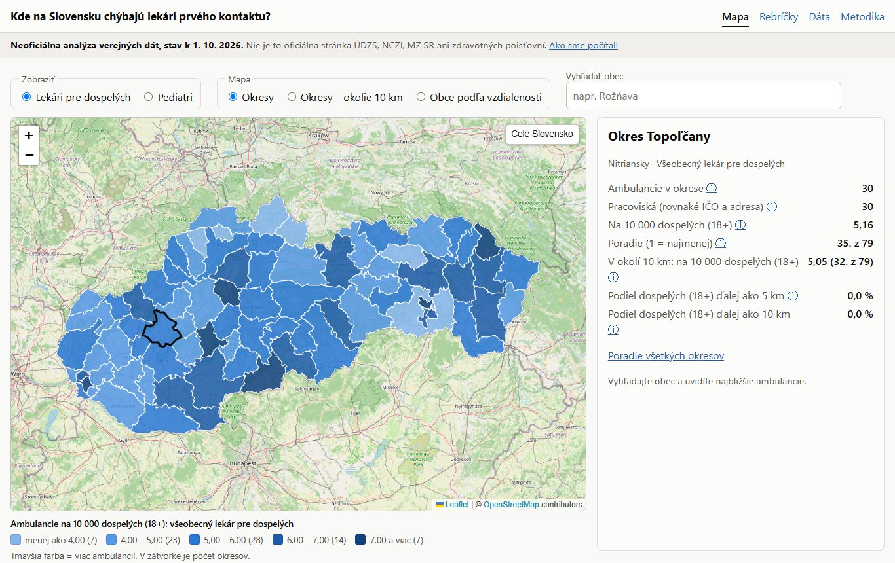
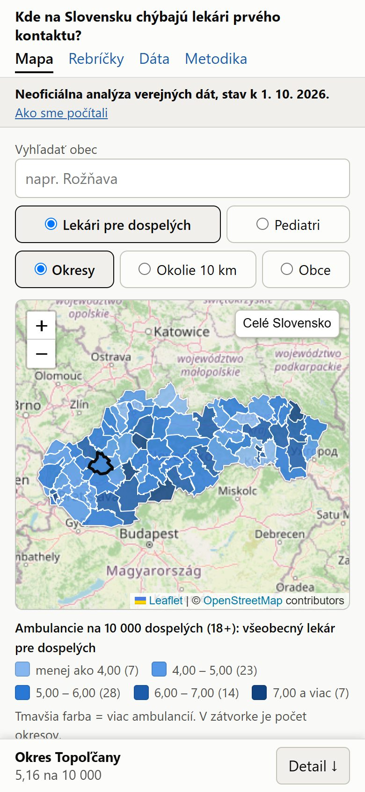
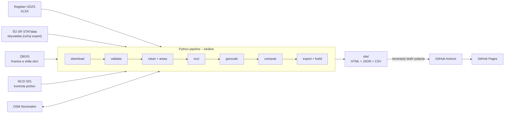

# Kde na Slovensku chýbajú lekári prvého kontaktu?

[](https://github.com/lukashavrilak-code/kde-chybaju-lekari/actions/workflows/ci.yml)
[](LICENSE)

Interaktívna mapa dostupnosti **všeobecných lekárov pre dospelých** a **pediatrov prvého kontaktu** pre každý okres a obec na Slovensku. Je to neoficiálna analýza verejných dát s reprodukovateľnou dátovou pipeline a otvorenou metodikou.

**[Otvoriť web](https://lukashavrilak-code.github.io/kde-chybaju-lekari/)** · [Metodika](docs/metodika.md) · [Technický prehľad](docs/sprievodca.md)

<p>
  
  
</p>

<sub>Mapový podklad © OpenStreetMap contributors.</sub>

> **English summary.** An unofficial open-data analysis of access to primary care physicians in Slovakia. A Python pipeline (pandas, geopandas, SQLite) finds and downloads the official provider register, validates it in every step, cross-checks counts against national health statistics (NCZI), geocodes practice addresses via OpenStreetMap Nominatim with a persistent cache and computes indicators: practices per 10,000 adults/children by district, distance to the nearest practice, and a two-step floating catchment (2SFCA) measure. The output is a static, privacy-friendly website (Leaflet, no backend, no cookies, strict CSP) hosted on GitHub Pages and deployed by GitHub Actions without personal or derived data in Git. Provider names stay on the author's machine: they enter neither the repository nor the website, and an automated check stops the build if one does.

## Čo z dát vychádza

Register k 1. 10. 2026, obyvatelia: stredný stav 2025. Vzdialenosti sú vzdušnou čiarou.

- V registri je **2 433** ambulancií všeobecných lekárov a **1 101** ambulancií pediatrov.
- Najbližšia ambulancia je ďalej ako 5 km pre **5,8 %** dospelých a **13,2 %** detí.
- Počet ambulancií na 10 000 dospelých sa po okresoch pohybuje od **2,66 do 17,55**. Keď sa započítajú aj ambulancie do 10 km mimo okresu (metóda 2SFCA), rozpätie sa zúži na **3,25 až 8,35**. Pri počítaní iba v hraniciach okresu vychádzajú rozdiely výrazne väčšie, najmä v Bratislave a Košiciach.

Stránka **neukazuje**, či ambulancia prijíma pacientov, ordinačné hodiny ani počet lekárov. Register tieto údaje neobsahuje. Všetky obmedzenia sú v [metodike](docs/metodika.md).

## Čo stránka ponúka

- mapu okresov zafarbenú podľa počtu ambulancií na 10 000 obyvateľov príslušnej vekovej skupiny, aj vrátane ambulancií v okolí 10 km,
- pre každú obec vzdialenosť k najbližšej ambulancii a počet ambulancií do 10 a 20 km, aj ako mapu obcí,
- podiel obyvateľov okresu, ktorí majú najbližšiu ambulanciu ďalej ako 5 a 10 km,
- adresy ambulancií v okolí s odkazom na oficiálne vyhľadávanie lekárov zdravotných poisťovní,
- rebríčky okresov a ukazovatele na stiahnutie (CSV).

## Hlavné technické riešenia

| Oblasť | Riešenie |
|---|---|
| Kvalita dát | kontroly OK/WARN/FAIL v každom kroku (súčty obyvateľov, formát kódov, poloha v obci z registra, porovnanie s NCZI). Pri chybe sa nič nezverejní. |
| Súkromie | minimalizácia: názvy poskytovateľov sú iba lokálne, kontrola V6.7 zastaví export, ak by sa dostali na web. Žiadne cookies ani analytika. |
| Bezpečnosť | prísna CSP, žiadne `innerHTML`, Leaflet lokálne so SRI, závislosti pripnuté s hashmi, GitHub Actions cez SHA, `pip-audit`, Dependabot |
| Testy | `pytest`, od jednotkových testov po celý beh na umelých dátach. Web sa testuje v skutočnom prehliadači na počítači aj v rozlíšení telefónu. |
| Geoúdaje | S-JTSK a WGS 84, vlastná validácia bodov oproti hraniciam obcí, 2SFCA, zákon zachovania ako kontrola výpočtu (V5.7) |
| Nasadenie | statické súbory, balík v neverejnom drafte vydania, nasadenie cez GitHub Actions s krátkodobým tokenom, bez dát v Gite |

## Architektúra



| Vrstva | Technológie |
|---|---|
| Dáta | Python 3.13, pandas, geopandas, shapely, SQLite |
| Web | statické HTML (Jinja2), vanilla JS (ES moduly), Leaflet 1.9.4 (lokálne, SRI) |
| Kvalita | kontroly v každom kroku, pytest, Playwright, ruff, pip-audit, Dependabot |
| Hosting | GitHub Pages, bez servera, cookies a analytiky |

## Ako spustiť (Windows, PowerShell)

Na umelých dátach to funguje bez akéhokoľvek sťahovania:

```powershell
py -3.13 -m venv .venv
.venv\Scripts\Activate.ps1
python -m pip install --require-hashes -r requirements.txt -r requirements-dev.txt
pre-commit install

python -m pipeline all --fixtures          # celý beh na umelých dátach
python -m pipeline serve --fixtures        # náhľad na http://127.0.0.1:8000
python -m pytest -q                        # testy (webové potrebujú Edge alebo Chrome)
```

Ostrý beh s reálnymi dátami popisuje [docs/runbook.md](docs/runbook.md).

## Štruktúra repozitára

| Cesta | Obsah |
|---|---|
| `pipeline/` | kroky spracovania, jeden modul na krok |
| `web/` | šablóny stránok, CSS, JS a lokálna kópia Leaflet |
| `docs/` | metodika, ochrana súkromia, test oprávneného záujmu, zdroje a licencie, denník overení, runbook, technický prehľad, zverejnenie |
| `data/manual`, `data/history` | ručné opravy a agregovaná história (bez osobných údajov) |
| `data/raw`, `data/snapshots`, `data/cache`, `data/local` | surové dáta, archív registra, cache geokódovania, databáza a reporty, iba lokálne, mimo Gitu |
| `tests/` | testy pytest |
| `config.toml` | URL, kódy odborností, prahy kontrol, polomery, legenda |

## Ochrana súkromia

Web zobrazuje iba adresu ambulancie, odbornosť a počet ambulancií na adrese. Názvy poskytovateľov nezobrazuje. Adresa však môže nepriamo určiť lekára, ak je na nej sám, preto projekt uvádza prevádzkovateľa a na žiadosť sa dá záznam skryť. Podrobnosti sú v [docs/sukromie.md](docs/sukromie.md) a [docs/lia.md](docs/lia.md). Otvorené otázky, vrátane právnej kontroly, sú v [denníku overení](docs/overenia.md).

## Autor a vznik projektu

Lukas Havrilak. Projekt vznikol s pomocou nástroja Claude Code od Anthropic, preto majú commity uvedeného spoluautora. Zadanie, rozhodnutia o dátach, metodike a ochrane súkromia aj kontrola výsledkov sú autorove.

## Zdroje a licencie

Kód: [MIT](LICENSE). Zdroje dát a ich podmienky: [docs/zdroje-a-licencie.md](docs/zdroje-a-licencie.md). Bezpečnosť: [SECURITY.md](SECURITY.md).
